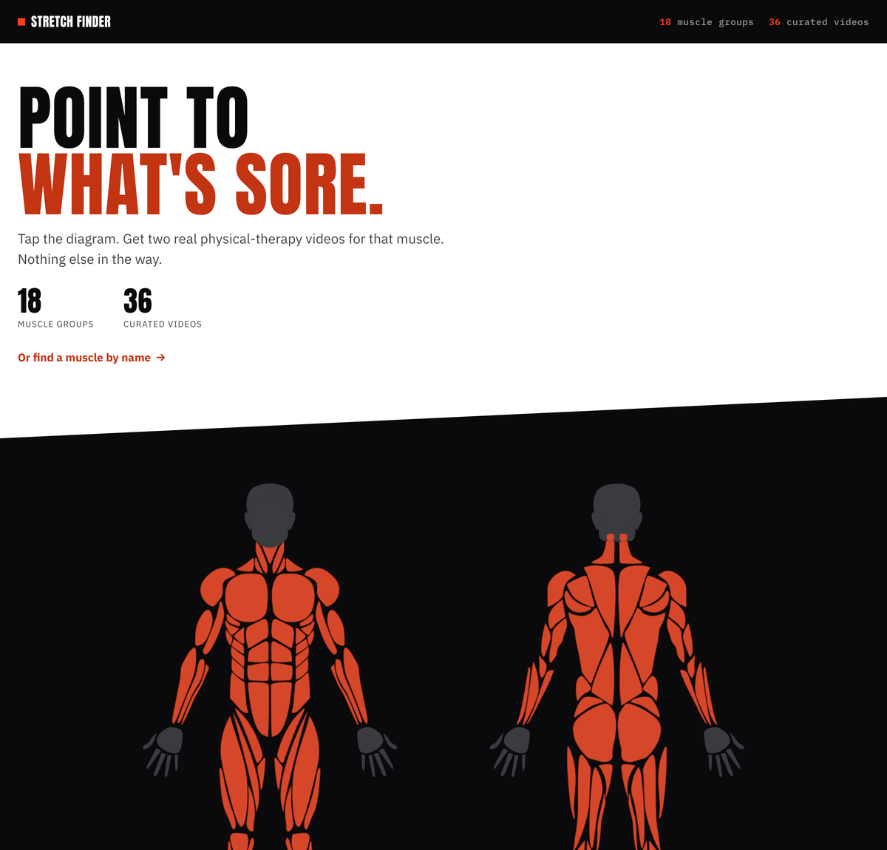
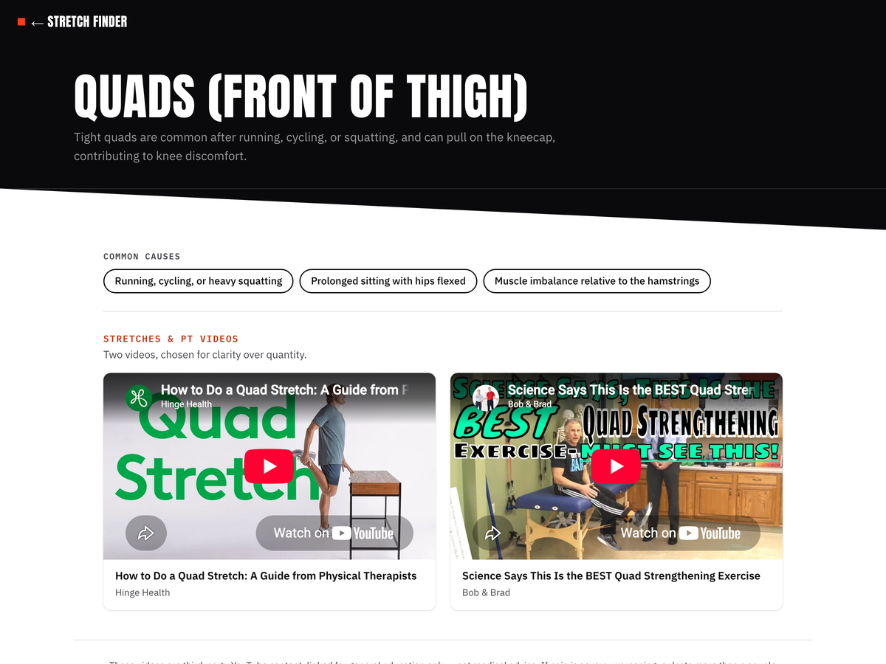

# Stretch Finder

Tap a muscle on an anatomical body diagram and get two curated stretch and physical-therapy videos for it. The whole
site works with JavaScript turned off.

**Live site:** https://mattthomas7641.github.io/stretch-finder/



## Features

- **Point to what's sore.** 18 muscle groups on a front and back diagram, each linking to a page with common causes
  and two videos (36 in total), chosen for clarity over quantity.
- **No JavaScript required.** Every muscle is a real link and the "find a muscle by name" list is a native
  `<details>` element. JavaScript only adds a hover and focus label.
- **Comfortable tap targets.** Each muscle gets an invisible, generously sized tap target sized from its measured
  bounding box, so a thin shape such as a neck or an Achilles tendon is still easy to tap on a phone.
- **Generated, not hand-edited.** Two small Python scripts build every page from a JSON content file and the diagram's
  path data.



## Run locally

No build step or server is needed to view it: open `index.html`. To match how links behave in production:

```bash
git clone https://github.com/mattthomas7641/stretch-finder.git
cd stretch-finder
python3 -m http.server 8000   # then open http://localhost:8000
```

## Editing content

| To change | Edit | Then run |
|---|---|---|
| A page's videos, intro or causes | `data/regions.json` | `python3 generate.py` |
| Which muscle links to which page | `MUSCLE_MAP` and `PAGE_LABELS` in `build_diagram.py` | `python3 build_diagram.py` |
| The home page's header, footer or script | `index.template.html` | `python3 build_diagram.py` |

To add a page, add an entry to `data/regions.json` with a unique `id`, `title`, `intro`, `causes` and `videos`
(YouTube video IDs), run `python3 generate.py`, and point a muscle at the new id in `MUSCLE_MAP`.

`index.html` and `regions/*.html` are generated. Edit the sources above, not those files.

## Project structure

```
index.html               Generated diagram page
index.template.html      Page shell for index.html
build_diagram.py         vendor path data + data/path-bboxes.json + template -> index.html
generate.py              data/regions.json + template.html -> regions/*.html
template.html            Template for each muscle page
data/regions.json        Content for every page (title, intro, causes, videos)
data/path-bboxes.json    Measured bounding box of each muscle path, used to size tap targets
style.css                Shared styles
vendor/                  Anatomical muscle path data (MIT licensed, see Credits)
docs/                    PRODUCT.md, DESIGN.md, screenshots
```

`data/path-bboxes.json` was generated once by loading every path into a browser and reading its `getBBox()`, because
the paths mix relative and absolute commands with elliptical arcs. If the vendor path data changes, regenerate it the
same way and re-run `build_diagram.py`.

## Notes

- Four pages (`hips`, `elbows`, `serratus-anterior`, `lats`) exist in `regions/` but are not linked from the diagram,
  because the path data does not draw those muscles as separate shapes.
- Videos are standard YouTube embeds, so they need an internet connection but no API key.
- The videos are third-party content for general education, not medical advice.

## Credits

The muscle shapes (`vendor/bodyFront.ts`, `vendor/bodyBack.ts`, `vendor/SvgMaleWrapper.tsx`) are from
[react-native-body-highlighter](https://github.com/HichamELBSI/react-native-body-highlighter) by Hicham El Abbassi,
used under the MIT License (see `vendor/LICENSE`).

## License

[MIT](LICENSE)
